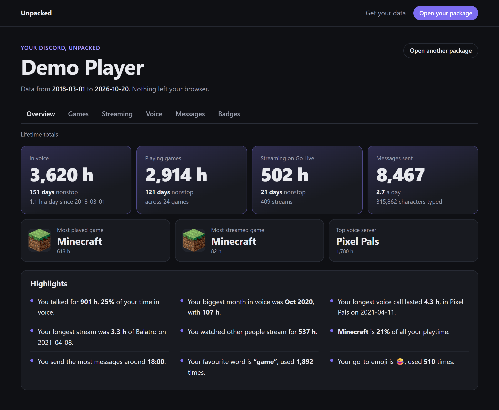
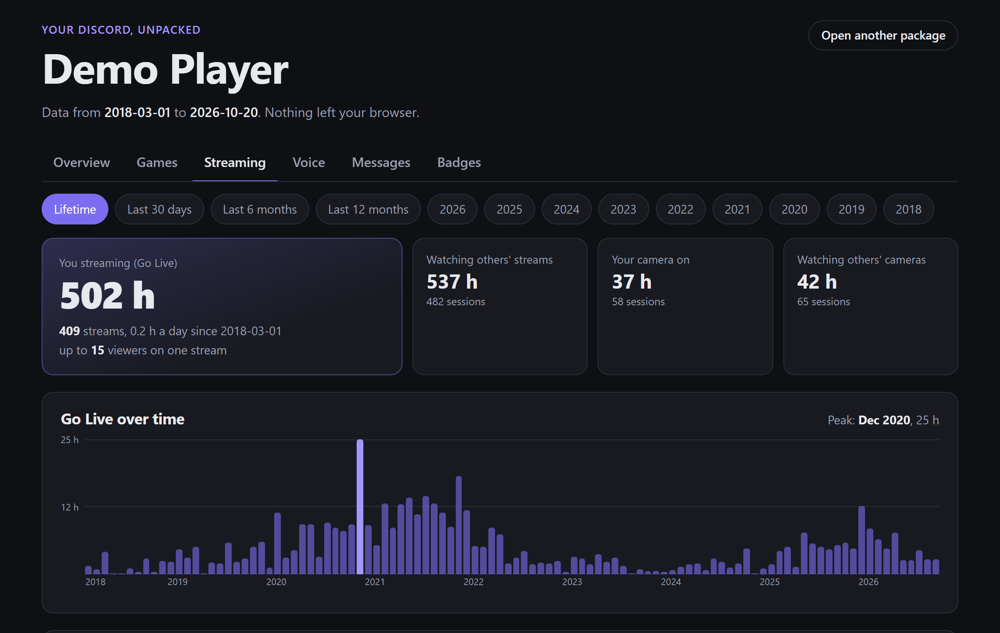
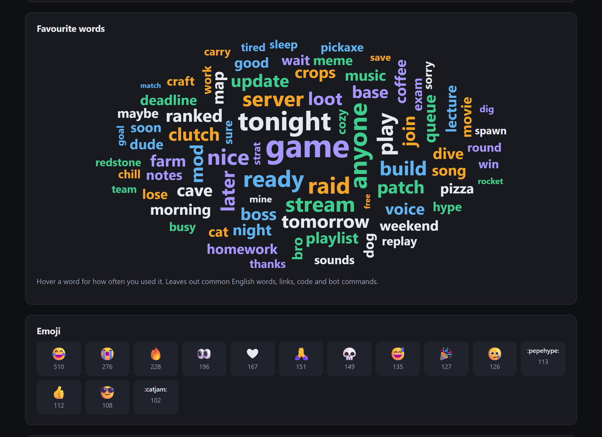
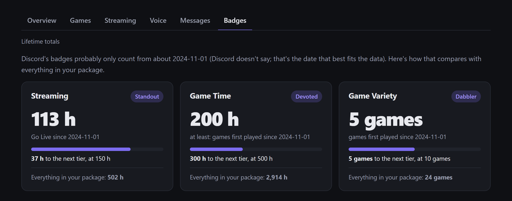

# Unpacked

[](https://app.netlify.com/projects/gentle-frangollo-4150ff/deploys)

Stats from your Discord data package: playtime per game, Go Live and watch time, voice, messages, and more. The site processes everything in your browser, so your package never leaves your machine.

**Try it: <https://unpacked.lockhart.in>**



| Streaming | Messages | Badges |
|---|---|---|
|  |  |  |

<sub>Screenshots use a made-up demo package, not anyone's real data.</sub>

**Status:** early. The site reads playtime, streaming, voice, messages and badges; the rest of [the checklist](docs/FEATURES.md) is still to do.

- [`site/`](site/): the website. Astro static pages plus plain TypeScript; the package is parsed in a Web Worker with the browser's own `DecompressionStream`, no other dependencies.
- [`docs/TODO.md`](docs/TODO.md): what's next (UI, new stats, SEO, loose ends).
- [`docs/FEATURES.md`](docs/FEATURES.md): feature checklist compared with existing tools, package format notes, and edge cases from their issue trackers.
- [`scripts/stats.py`](scripts/stats.py): Python prototype of the playtime, streaming, voice and badge parsing (stdlib only).

## Running the site

Needs Node 22.12 or newer.

```sh
cd site
npm install
npm run dev                                   # http://localhost:4321
npm run build                                 # static files in site/dist/
node scripts/check.ts ../data/package.zip     # run the parser on a real package and print the numbers
```

To get a package without using your own, `node scripts/demo-package.ts ../data/demo-package.zip` writes a made-up one (same every time; real game ids, invented everything else). [`scripts/screenshots.ts`](site/scripts/screenshots.ts) takes the README screenshots from it with headless Chrome.

## Deploying

The site is hosted on Netlify at <https://unpacked.lockhart.in>. [`netlify.toml`](netlify.toml) builds `site/` on every push to `main` and sets a Content-Security-Policy that only allows requests to the site itself and `discord.com` (for game names), so the browser enforces that packages are never uploaded.

## Trying the prototype

1. Request your data from Discord: User Settings → Data & Privacy → Request Data.
2. Extract `package.zip` into `data/package/`. The `data/` folder is gitignored.
3. Run:

```sh
python3 scripts/stats.py playtime            # hours per game
python3 scripts/stats.py streams             # Go Live / watching / camera time
python3 scripts/stats.py streams --since 2024-01-01
python3 scripts/stats.py voice               # time in voice, talking / listening, top servers
python3 scripts/stats.py badges              # your profile badges vs the package totals
```

Game names are looked up from Discord's public application endpoints and cached in `data/cache/`.

## Feedback

Found a bug, or want a stat that isn't there? [Open an issue](https://github.com/LOCKhart07/unpacked/issues/new/choose). Please don't attach your package; it's personal.

## License

[GPL-3.0](LICENSE)
